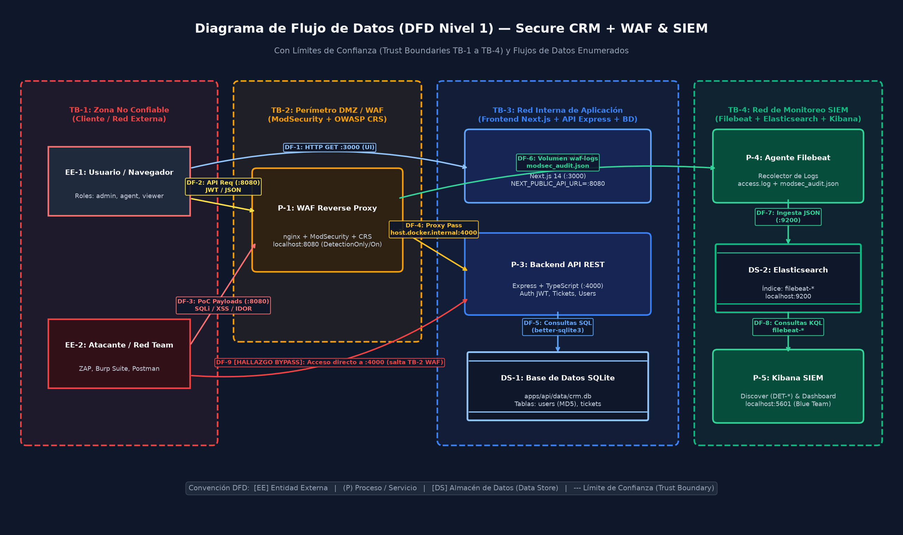
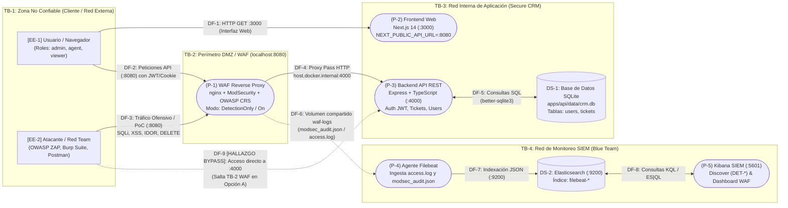
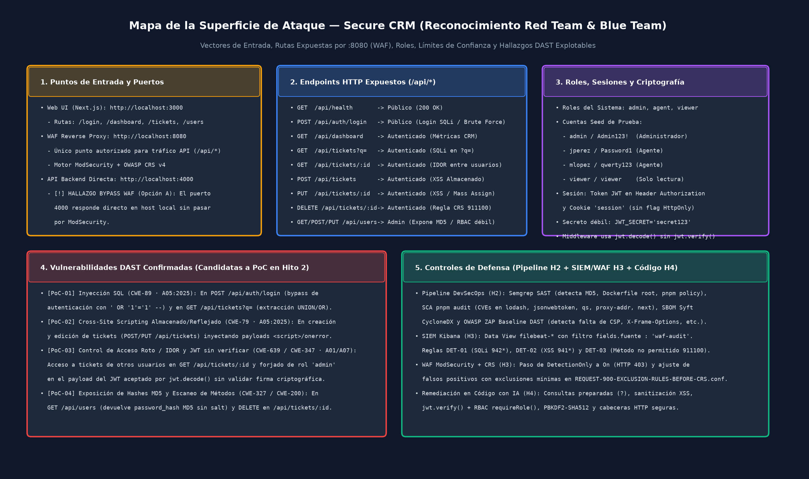

# Hito 1 · Diseño seguro (Secure SDLC + PASTA + STRIDE)

## Integrantes y roles

| Nombre | Usuario GitHub | Rol |
|---|---|---|
| **Fabiola Contreras** | [@Fabiola-cc](https://github.com/Fabiola-cc) | Equipo rojo (Red Team) |
| **María José Villafuerte** | [@Maria-Villafuerte](https://github.com/Maria-Villafuerte) | Equipo rojo (Red Team) |
| **Andree Toledo** | [@andreetoledo](https://github.com/andreetoledo) | Equipo azul (Blue Team) |
| **Sofía Velásquez** | [@Sofiamishel2003](https://github.com/Sofiamishel2003) | Equipo azul (Blue Team) |

---

## 1. Diagrama de Flujo de Datos (DFD) con Límites de Confianza

El siguiente Diagrama de Flujo de Datos (DFD Nivel 1) modela la arquitectura completa de **Secure CRM** integrada con el proxy inverso **WAF (ModSecurity + OWASP CRS)** y el **SIEM (Filebeat + Elasticsearch + Kibana)**, demarcando los cuatro **Límites de Confianza (*Trust Boundaries*, `TB-1` a `TB-4`)**:

### Elementos y Límites de Confianza del DFD

| Código | Tipo | Componente | Descripción y Límite de Confianza |
|---|---|---|---|
| **TB-1** | Límite de Confianza | **Zona No Confiable (Cliente / Atacante)** | Entorno externo fuera del control del servidor (navegador web del usuario en `EE-1` y herramientas de ataque `ZAP`, `Burp Suite` y `Postman` del Red Team en `EE-2`). Ninguna entrada que cruce de `TB-1` hacia `TB-2` o `TB-3` es confiable. |
| **TB-2** | Límite de Confianza | **Perímetro DMZ / WAF (`localhost:8080`)** | Punto de inspección perimetral compuesto por **nginx + ModSecurity + OWASP Core Rule Set (CRS)** (`P-1`). Inspecciona cabeceras, query strings, métodos HTTP y cuerpos JSON antes de reenviar al backend. |
| **TB-3** | Límite de Confianza | **Red Interna de Aplicación (Secure CRM)** | Contiene el Frontend SSR/CSR en **Next.js 14** (`P-2`, puerto `3000`), la **API REST en Express + TypeScript** (`P-3`, puerto `4000`) y el almacén persistente **SQLite** (`DS-1`, `apps/api/data/crm.db`). |
| **TB-4** | Límite de Confianza | **Red de Monitoreo y Telemetría (SIEM)** | Plano de observabilidad exclusivo del **Blue Team**, integrado por **Filebeat** (`P-4`), **Elasticsearch** (`DS-2`, `:9200`) y **Kibana** (`P-5`, `:5601`), donde se almacenan los registros de auditoría del WAF (`modsec_audit.json`). |

---

## 2. Modelado de Amenazas con STRIDE

Cada categoría de **STRIDE** se aterriza sobre los componentes y archivos reales de **Secure CRM**:

| Letra | Categoría STRIDE | Amenaza Específica en Secure CRM | Componente Afectado (DFD / Código) | Control de Seguridad (Preventivo y Detectivo) |
|---|---|---|---|---|
| **S** | **Suplantación** (*Spoofing*) | **1)** Bypass de autenticación mediante Inyección SQL (`' OR '1'='1' --`) en el formulario de login. **2)** Falsificación de sesión mediante tokens JWT alterados cuya firma criptográfica no es verificada por el servidor. | `P-3: Backend API` - `apps/api/src/auth.ts` (`POST /api/auth/login`) - `apps/api/src/middleware/auth.ts` (`jwt.decode()`) | **Código (H4):** Consultas preparadas parametrizadas (`?`) en SQLite y validación estricta `jwt.verify(token, JWT_SECRET, { algorithms: ['HS256'] })`. **SIEM/WAF (H3):** Regla `DET-01` en Kibana y bloqueo CRS `942*` (SQLi) en modo `On`. |
| **T** | **Manipulación** (*Tampering*) | **1)** Inyección de scripts maliciosos (**XSS Almacenado y Reflejado**) en los campos `title`, `description` y `customerEmail` al crear o editar tickets. **2)** Escalada de privilegios por *Mass Assignment* o manipulación de roles en `/api/users`. | `P-2: Frontend Web` y `P-3: Backend API` - `apps/api/src/routes/tickets.ts` - `apps/web/app/tickets/[id]/page.tsx` (`dangerouslySetInnerHTML`) | **Código (H4):** Eliminación de `dangerouslySetInnerHTML`, sanitización de entradas/salidas y cabeceras `Content-Security-Policy` (CSP). **SIEM/WAF (H3):** Regla `DET-02` en Kibana y bloqueo CRS `941*` (XSS) en modo `On`. |
| **R** | **Repudio** (*Repudiation*) | Ejecución de acciones destructivas (eliminación de tickets con `DELETE /api/tickets/:id`, cambios de rol o intentos de acceso ilegítimos) sin trazabilidad de auditoría en la base de datos de la aplicación ni correlación de IP. | `P-3: Backend API` y `P-1: WAF` - `apps/api/src/routes/tickets.ts` - `apps/api/src/routes/users.ts` | **SIEM (H3):** Centralización inmutable de `access.log` y `modsec_audit.json` vía Filebeat hacia Elasticsearch (`filebeat-*`), registrando `@timestamp`, `client_ip`, `uri`, método y payload; regla `DET-03` (`911100`). |
| **I** | **Divulgación de información** (*Information Disclosure*) | **1)** Extracción masiva de tickets de otros clientes vía SQLi en `GET /api/tickets?q=` o **IDOR** en `GET /api/tickets/:id`. **2)** Exposición de hashes de contraseña débiles (**MD5 sin salt**) en `GET /api/users` y fuga de *stack traces* / cabecera `X-Powered-By`. | `P-3: Backend API` y `DS-1: SQLite` - `apps/api/src/routes/tickets.ts` - `apps/api/src/routes/users.ts` - `apps/api/src/hash.ts` (`md5`) - `apps/api/src/index.ts` | **Pipeline (H2):** SAST Semgrep (`md5-used-as-password`) y DAST ZAP (`X-Powered-By`). **Código (H4):** Hashing con `PBKDF2-SHA512 + salt`, omisión de `password_hash` en respuestas JSON, control de acceso por propietario/rol y ocultamiento de errores 500. |
| **D** | **Denegación de servicio** (*Denial of Service*) | **1)** Ráfagas automatizadas de fuerza bruta y escaneo agresivo contra `POST /api/auth/login` y `/api/tickets` (ausencia de *Rate Limiting*). **2)** Explotación de dependencias vulnerables a DoS/ReDoS (`qs`, `braces`, `postcss`). | `P-1: WAF` y `P-3: Backend API` - `apps/api/src/auth.ts` - Árbol de dependencias `pnpm-lock.yaml` | **Pipeline (H2):** SCA `pnpm audit` para detectar CVEs de DoS en dependencias. **SIEM (H3):** Consulta ES\|QL de detección de ráfagas por IP (`COUNT(*) > 20` por minuto) en Kibana y contención en WAF. |
| **E** | **Elevación de privilegios** (*Elevation of Privilege*) | **1)** Un usuario con rol `viewer` o `agent` modifica el payload de su JWT (`"role": "admin"`) o invoca endpoints administrativos (`GET/POST /api/users`, `DELETE /api/tickets/:id`) sin control RBAC en el servidor. **2)** Ejecución de contenedores Docker como `root` (UID 0). | `P-3: Backend API` y Contenedores - `apps/api/src/middleware/auth.ts` - `apps/api/src/routes/users.ts` - `apps/api/Dockerfile`, `apps/web/Dockerfile` | **Pipeline (H2):** SAST Semgrep (`dockerfile.security.missing-user`). **Código (H4):** Middleware `requireRole('admin')` con verificación criptográfica de JWT y directiva `USER node` en Dockerfiles. |

### Matriz STRIDE por Componente del DFD

La tabla anterior organiza STRIDE por categoría. Esta segunda vista recorre **cada componente del DFD** (procesos `P-*` y almacenes `DS-*`) y le asigna al menos una amenaza STRIDE aplicable con su control, para no dejar ningún elemento del diagrama sin analizar:

| Componente del DFD | Límite | Letra(s) STRIDE aplicable(s) | Amenaza concreta en ese componente | Control por componente |
|---|---|---|---|---|
| **P-1 · WAF (ModSecurity + CRS, `:8080`)** | TB-2 | **R, D, E** | **R/E:** evasión del WAF atacando directamente `:4000` (`DF-9`), sin registro en `modsec_audit.json`. **D:** ráfagas/escaneo que saturan la inspección. | Opción B de despliegue (ocultar `:4000` en la red Docker); `MODSEC_RULE_ENGINE=On`; logging de auditoría hacia el SIEM; `BLOCKING_PARANOIA` ajustable. |
| **P-2 · Frontend Next.js (`:3000`)** | TB-3 | **T, I** | **T/I:** XSS reflejado (término `?q=`) y almacenado (descripción) renderizados con `dangerouslySetInnerHTML` ([`tickets/page.tsx:69`](../../apps/web/app/tickets/page.tsx#L69), [`tickets/[id]/page.tsx:93`](../../apps/web/app/tickets/[id]/page.tsx#L93)); fuga de la cookie `session` sin `HttpOnly`. | Eliminar `dangerouslySetInnerHTML`/escapar salida; cabecera `Content-Security-Policy`; cookie `HttpOnly`+`Secure`+`SameSite`. |
| **P-3 · Backend API Express (`:4000`)** | TB-3 | **S, T, R, I, E** | **S:** SQLi en login y JWT sin verificar firma. **T/E:** mass assignment de `role` y falta de RBAC. **I:** fuga de hashes y stack traces. **R:** acciones destructivas sin auditoría propia. | Consultas parametrizadas; `jwt.verify()`; `requireRole`; lista blanca de campos; ocultar errores 500; `helmet`; registrar eventos de seguridad hacia el SIEM. |
| **DS-1 · SQLite (`crm.db`)** | TB-3 | **I, T** | **I:** volcado de `users`/`tickets` vía SQLi. **T:** modificación/borrado de registros sin control de acceso. | Consultas parametrizadas; principio de mínimo privilegio en el acceso a datos; hashing fuerte (PBKDF2/argon2) de `password_hash`. |
| **P-4 · Filebeat** | TB-4 | **T, I** | **T:** manipulación de los logs en tránsito o del archivo de auditoría. **I:** los logs pueden contener cuerpos de peticiones con credenciales de prueba. | Volumen de solo lectura hacia los logs; red SIEM aislada; no registrar secretos (CWE-532); en producción, canal cifrado a Elasticsearch. |
| **DS-2 · Elasticsearch (`:9200`)** | TB-4 | **I, D, S** | **I/S:** seguridad de Elastic deshabilitada en el laboratorio (acceso sin auth). **D:** saturación del índice `filebeat-*`. | Enlazado solo a `127.0.0.1`; en producción, habilitar `xpack.security`, autenticación y TLS; política de retención/ILM. |
| **P-5 · Kibana (`:5601`)** | TB-4 | **S, E** | **S/E:** acceso sin autenticación al SIEM permitiría leer o alterar tableros y reglas de detección. | Enlazado solo a `127.0.0.1`; en producción, autenticación y RBAC de Kibana; espacios y roles de solo lectura para el Blue Team. |

---

## 3. Metodología PASTA (Etapas 1 a 5)

### Etapa 1 · Objetivos del negocio (*Define Objectives*)
**Secure CRM** es la plataforma central de gestión de tickets de soporte al cliente y administración de agentes internos de la organización.
- **Objetivos de negocio y seguridad:**
  1. **Confidencialidad de la información de clientes y empleados:** Proteger los datos personales de clientes (correos, incidencias reportadas en tickets) y las credenciales de los usuarios internos (`admin`, `agent`, `viewer`).
  2. **Integridad operativa del flujo de soporte:** Garantizar que solo usuarios autenticados y con el rol autorizado puedan crear, modificar, reasignar o eliminar tickets y cuentas de usuario.
  3. **Disponibilidad y trazabilidad ante incidentes:** Mantener la continuidad del servicio de atención al cliente y asegurar que todo intento de ataque quede registrado en tiempo real en el SIEM para respuesta oportuna del Blue Team.
  4. **Cumplimiento en el ciclo de desarrollo (SSDLC):** Asegurar que ningún cambio de código o dependencia con vulnerabilidades críticas/altas llegue a producción sin pasar por controles automatizados (SAST, SCA, SBOM, DAST) y auditoría de código.

### Etapa 2 · Alcance técnico (*Define Technical Scope*)
El entorno técnico bajo análisis comprende los siguientes activos y tecnologías:
- **Repositorio y gestión de paquetes:** Monorepo gestionado con `pnpm@10.12.1` (`pnpm-workspace.yaml`, `pnpm-lock.yaml`) sobre **Node.js 20** (`node:20-bookworm`).
- **Frontend Web (`apps/web`):** Aplicación **Next.js 14.2.15** con React 18 y TailwindCSS, expuesta en `http://localhost:3000`, configurada mediante `NEXT_PUBLIC_API_URL=http://localhost:8080` para enrutar todo el tráfico de cliente a través del WAF.
- **Backend API REST (`apps/api`):** Servidor **Express 4.21** en TypeScript, escuchando en `http://localhost:4000`, con autenticación basada en **JWT** (`jsonwebtoken`) y cookies de sesión.
- **Base de Datos (`apps/api/data/crm.db`):** Motor relacional embebido **SQLite** accedido mediante el driver nativo síncrono `better-sqlite3`, con dos tablas principales: `users` y `tickets`.
- **Defensa Perimetral WAF (`waf-siem`):** Contenedor Docker `owasp/modsecurity-crs:nginx` expuesto en `http://127.0.0.1:8080`, operando con **ModSecurity v3** y **OWASP Core Rule Set (CRS)** (`BLOCKING_PARANOIA=1`), inicialmente en `MODSEC_RULE_ENGINE=DetectionOnly` (Hitos 0–2) y posteriormente en `MODSEC_RULE_ENGINE=On` (Hito 3).
- **Monitoreo SIEM (`waf-siem`):** Stack **Elastic 9.3.3** en Docker Compose conformado por **Filebeat** (ingesta de `/var/log/waf/access.log` y `/var/log/waf/modsec_audit.json`), **Elasticsearch** (`http://127.0.0.1:9200`) y **Kibana** (`http://127.0.0.1:5601`).

### Etapa 3 · Descomposición de la aplicación (*Application Decomposition*)
La aplicación se descompone en los siguientes módulos funcionales y flujos de confianza:
1. **Módulo de Autenticación y Sesión (`apps/api/src/auth.ts`, `hash.ts`, `middleware/auth.ts`):**
   - Recibe credenciales en `POST /api/auth/login`, calcula el hash de la contraseña con `weakHash()` ([`apps/api/src/hash.ts:6`](../../apps/api/src/hash.ts#L6), MD5 sin salt) y consulta la tabla `users`.
   - Emite un token JWT firmado con `JWT_SECRET` (`secret123`) y establece la cookie `session` en el navegador.
   - El middleware `requireAuth` intercepta las peticiones a rutas protegidas leyendo el encabezado `Authorization: Bearer <token>` o la cookie `session`.
2. **Módulo de Gestión de Tickets (`apps/api/src/routes/tickets.ts`):**
   - Permite listar y filtrar tickets (`GET /api/tickets?q=`), consultar el detalle de un ticket (`GET /api/tickets/:id`), crear tickets (`POST /api/tickets`), actualizarlos (`PUT /api/tickets/:id`) y eliminarlos (`DELETE /api/tickets/:id`).
3. **Módulo de Administración de Usuarios (`apps/api/src/routes/users.ts`):**
   - Gestiona el listado de usuarios (`GET /api/users`), detalle individual (`GET /api/users/:id`), creación de cuentas (`POST /api/users`) y actualización de roles (`PUT /api/users/:id/role`).
4. **Módulo de Métricas y Dashboard (`apps/api/src/routes/dashboard.ts`):**
   - Agrega estadísticas de tickets por estado (`open`, `in_progress`, `resolved`, `closed`) y prioridad (`low`, `medium`, `high`, `urgent`) en `GET /api/dashboard`.

### Etapa 4 · Análisis de amenazas (*Threat Analysis*)
A partir de la descomposición de componentes y el modelo STRIDE, se identifican los escenarios de amenaza prioritarios:
1. **Compromiso total de autenticación y extracción de base de datos vía Inyección SQL:** Un atacante externo envía metacaracteres SQL (`' OR '1'='1' --` o `UNION SELECT`) a través de `POST /api/auth/login` o `GET /api/tickets?q=` para autenticarse como `admin` sin conocer la contraseña o volcar registros confidenciales de `crm.db`.
2. **Secuestro de sesión y ejecución de código en el navegador de agentes/administradores vía XSS:** Un atacante inyecta payloads JavaScript (``),
- **Entonces** en la versión vulnerable con el WAF en `DetectionOnly` el payload se almacena en SQLite y se ejecuta en el navegador de cualquier agente o administrador al abrir el ticket; pero el evento queda capturado en **Kibana** bajo la regla `DET-02 XSS` (`ruleId : 941*`), al activar el WAF en modo `On` la petición es bloqueada con `HTTP 403`, y en el Hito 4 la eliminación de `dangerouslySetInnerHTML` junto con la cabecera `Content-Security-Policy` impide la ejecución del script en el navegador.

### CA-03 · Acceso no autorizado a tickets de otros clientes (IDOR) y eliminación sin privilegios
- **Dado** que un usuario con rol restringido (`viewer` o un agente distinto al asignado) desea leer o eliminar tickets confidenciales pertenecientes a otros clientes en `/api/tickets/:id`,
- **Cuando** itera sobre los identificadores numéricos enviando `GET http://localhost:8080/api/tickets/1` o `DELETE http://localhost:8080/api/tickets/1`,
- **Entonces** en la versión vulnerable la API entrega los datos del ticket ajeno o lo elimina sin verificar propiedad ni rol `admin`; el intento `DELETE` es detectado en **Kibana** por la regla `DET-03` (`ruleId : 911100`), es bloqueado con `HTTP 403` por el WAF mientras `DELETE` no esté autorizado, y tras la remediación de control de acceso (RBAC) en el Hito 4, el propio backend devuelve `HTTP 403 Forbidden` ante usuarios sin el rol requerido.

### CA-04 · Escalada de privilegios mediante falsificación de Token JWT sin verificación de firma
- **Dado** que un atacante autenticado como `viewer` obtiene su token JWT legítimo y observa que el backend utiliza `jwt.decode()` en lugar de `jwt.verify()`,
- **Cuando** modifica la sección *payload* (Base64URL) del token cambiando `"role": "viewer"` a `"role": "admin"` con una firma inválida y solicita `GET http://localhost:8080/api/users`,
- **Entonces** la versión vulnerable le concede acceso administrativo y le expone la lista de usuarios con sus hashes MD5; pero una vez aplicada la remediación en `apps/api/src/middleware/auth.ts` (`jwt.verify(token, JWT_SECRET, { algorithms: ['HS256'] })`) en el Hito 4, cualquier alteración del payload invalida la firma criptográfica y la API rechaza la petición con `HTTP 401 Invalid token`.

### CA-05 · Evasión del WAF atacando directamente el puerto expuesto del Backend
- **Dado** que la aplicación se levanta en modo local (Opción A) publicando el puerto `4000` del contenedor `api` en la máquina host además del puerto `8080` del WAF,
- **Cuando** un atacante envía sus payloads de Inyección SQL o XSS directamente a `http://localhost:4000/api/auth/login` en lugar de `http://localhost:8080/api/auth/login`,
- **Entonces** la petición alcanza el backend Express sin pasar por el contenedor `waf` (`owasp/modsecurity-crs:nginx`), por lo que el ataque no genera registros en `modsec_audit.json` ni es bloqueado aunque `MODSEC_RULE_ENGINE=On` esté activo; este abuso demuestra por qué el aislamiento de red (Opción B en Docker Compose) y la remediación en el código fuente (Hito 4) son indispensables para no depender únicamente del WAF.

### CA-06 · Introducción de código inseguro o dependencias alucinadas (*Slopsquatting*) por Asistente de IA
- **Dado** que el equipo de desarrollo utiliza un asistente de IA generativa en el Hito 4 para parchar vulnerabilidades en el backend de Secure CRM,
- **Cuando** la IA sugiere instalar un paquete inexistente o malicioso en `package.json`, deja un secreto hardcodeado o mantiene una construcción insegura en TypeScript/Dockerfile,
- **Entonces** la auditoría obligatoria del Hito 4 (ejecución automática de **SAST Semgrep** y **SCA `pnpm audit`** en el pipeline de GitHub Actions, verificación de existencia real en el registro oficial de npm y revisión manual con la checklist de la Lectura 10) detecta y rechaza el cambio antes de integrarlo a la rama principal.
