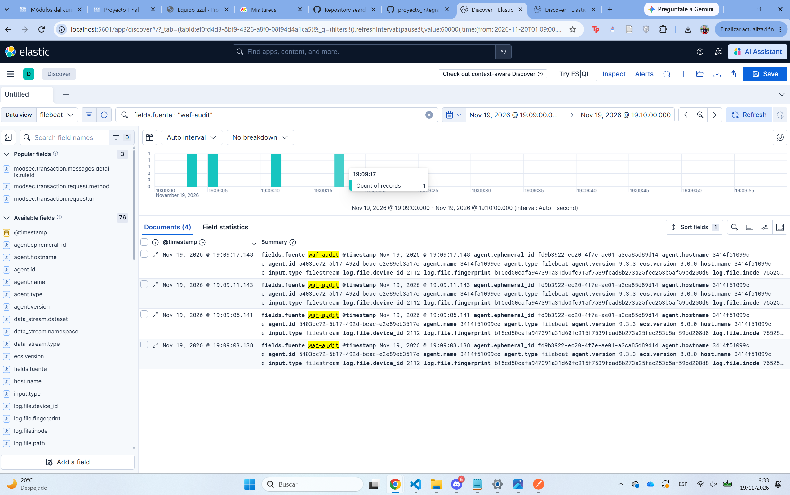
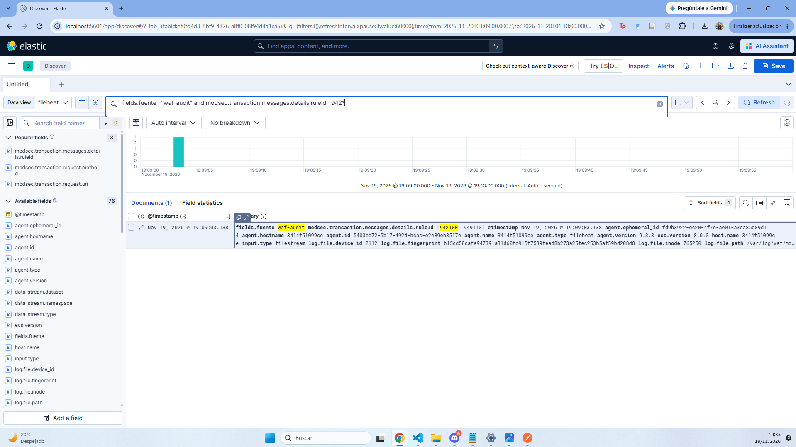
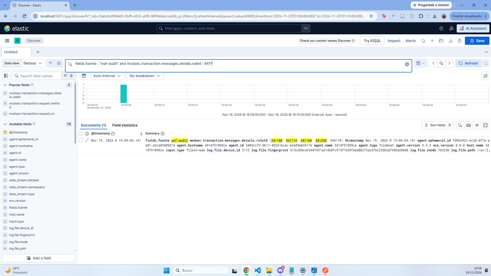
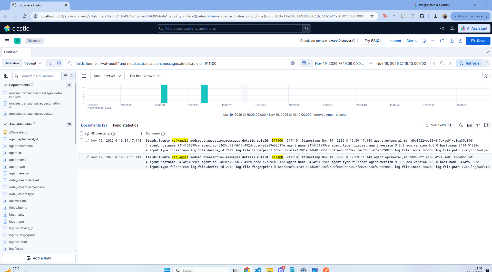
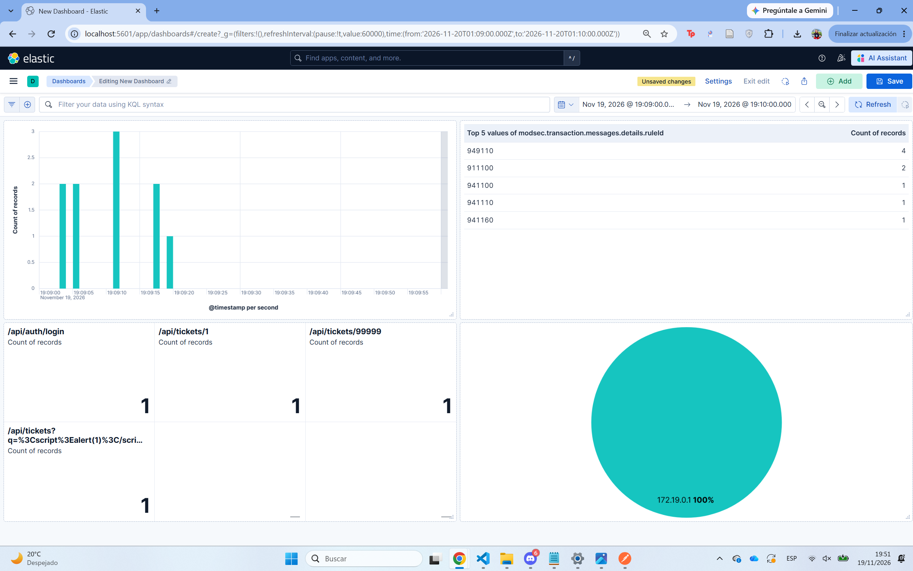
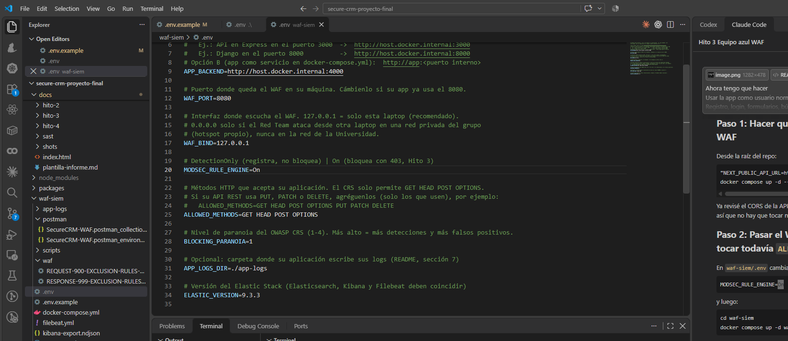
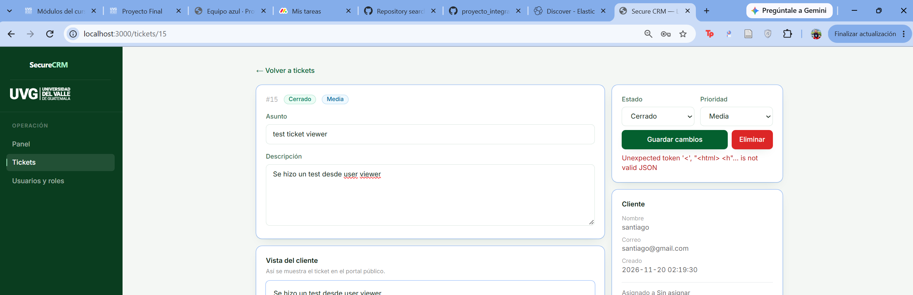
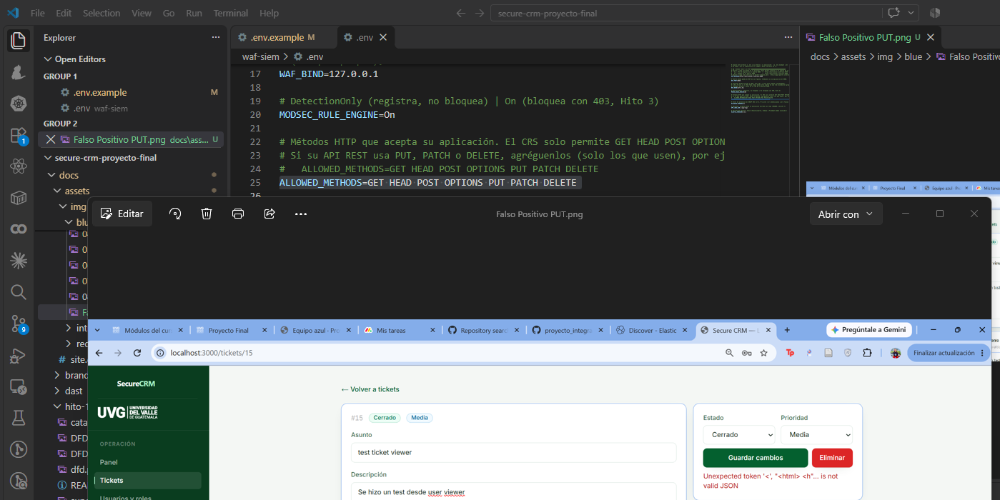

# Hito 3 · Detección en SIEM y Respuesta Activa en WAF (Equipo Azul)

- **Integrantes responsables (Equipo Azul):**
  - **Andree Toledo** ([@andreetoledo](https://github.com/andreetoledo))
  - **Sofía Velásquez** ([@Sofiamishel2003](https://github.com/Sofiamishel2003))
- **Exportación de Saved Objects de Kibana** (reglas `DET-01..03`, dashboard y data view): [`waf-siem/kibana-export.ndjson`](../../waf-siem/kibana-export.ndjson)
- **Archivo de exclusiones del WAF:** [`waf-siem/waf/REQUEST-900-EXCLUSION-RULES-BEFORE-CRS.conf`](../../waf-siem/waf/REQUEST-900-EXCLUSION-RULES-BEFORE-CRS.conf)
- **Configuración del WAF:** `waf-siem/.env` (no versionado; valores relevantes documentados en la §4 y en [`waf-siem/.env.example`](../../waf-siem/.env.example))

> **Nota sobre las fechas de la evidencia.** Cada integrante levanta su propio stack (WAF + Elasticsearch + Kibana) en `localhost`. Las PoC del Equipo Rojo del 2026-11-13 ([Hito 2 §3](../hito-2/README.md)) quedaron en el Elasticsearch de su laptop. Para este hito los PoC se **repitieron el 2026-11-19 contra el entorno del Equipo Azul**, con la colección de Postman del Red Team (`waf-siem/postman/`). Todas las horas de este documento son **hora local de Guatemala (UTC−6)**; entre paréntesis va el `@timestamp` UTC que guarda Elasticsearch.

---

## 1. Conexión de la aplicación al WAF y riesgo de la opción elegida

- **Modalidad: Opción A.** La API corre como contenedor del `docker-compose.yml` raíz, publicada en `:4000`, y el WAF la alcanza con `APP_BACKEND=http://host.docker.internal:4000`.
- **El frontend pasa por el WAF:** la web se compila con `NEXT_PUBLIC_API_URL=http://localhost:8080` (archivo `.env` de la raíz), de modo que el navegador (`:3000`), Postman, ZAP y Burp envían todo a `http://localhost:8080`. ModSecurity v3 + OWASP CRS v4 inspecciona cada petición, escribe `/var/log/waf/modsec_audit.json` (Filebeat → Elasticsearch → Kibana) y reenvía a la API.
- **Riesgo aceptado (bypass del WAF):** en la Opción A la API sigue publicada en `localhost:4000`. Una petición directa a `http://localhost:4000/api/...` responde sin pasar por ModSecurity y sin dejar rastro en el SIEM. El Red Team lo demostró (`bypass-4000.png`, [Hito 2](../hito-2/README.md); `DF-9` del DFD del Hito 1).
- **Mitigación (Opción B, producción):** agregar la API como servicio del `docker-compose.yml` del WAF con `expose: ["4000"]` (sin `ports:`) y `APP_BACKEND=http://api:4000`. Así la API solo es alcanzable desde la red interna de Docker. Queda como **riesgo residual** en el informe final.

---

## 2. Reglas de detección en Kibana (WAF en `DetectionOnly`)

Data view **`filebeat`** (patrón `filebeat-*`, campo de tiempo `@timestamp`).



Las reglas son búsquedas guardadas de Discover, exportadas en `kibana-export.ndjson`. Se filtran por **ID exacto de regla del CRS**: los campos `modsec.*` son *keyword*, y un comodín como `942*` no es confiable.

| Regla | Consulta KQL guardada | Ataque que detecta |
|---|---|---|
| **DET-01 SQLi** | `fields.fuente : "waf-audit" and modsec.transaction.messages.details.ruleId : 942100` | PoC-01 · SQLi en el login (CWE-89) |
| **DET-02 XSS** | `fields.fuente : "waf-audit" and modsec.transaction.messages.details.ruleId : "941100"` | PoC-02 · XSS en la búsqueda de tickets (CWE-79) |
| **DET-03 Metodo** | `fields.fuente : "waf-audit" and modsec.transaction.messages.details.ruleId : 911100` | Métodos HTTP fuera de política (ver nota en §5) |

### Evidencia: ataques reales repetidos el 2026-11-19 (WAF en `DetectionOnly`)

| Hora local (UTC) | Petición (Postman → `:8080`) | Respuesta | Reglas disparadas | `details.data` (payload que la disparó) | Regla |
|---|---|---|---|---|---|
| 19:09:03.138 (01:09:03Z) | `POST /api/auth/login` — PoC-01 | `200` (token de admin) | `942100` *SQL Injection Attack Detected via libinjection* · `949110` (score 5) | `Matched Data: s&sos found within ARGS:json.username: admin' OR '1'='1' --` | **DET-01** |
| 19:09:05.141 (01:09:05Z) | `GET /api/tickets?q=<script>alert(1)</script>` — PoC-02 | `200` (término reflejado) | `941100`, `941110`, `941160`, `941390` · `949110` (score 20) | `Matched Data: XSS data found within ARGS:q: <script>alert(1)</script>` (941100) · `<script> found within ARGS:q` (941110) · `alert( found within ARGS:q` (941390) | **DET-02** |
| 19:09:11.143 (01:09:11Z) | `DELETE /api/tickets/99999` | `404` | `911100` *Method is not allowed by policy* · `949110` (score 5) | `DELETE` | **DET-03** |
| 19:09:17.148 (01:09:17Z) | `DELETE /api/tickets/1` (token viewer) — PoC-03 | `200` (ticket borrado) | `911100` · `949110` (score 5) | `DELETE` | **DET-03** |

En `DetectionOnly` el WAF **registra pero no bloquea**: los cuatro ataques llegaron a la API y tuvieron éxito. La regla `949110` (*Inbound Anomaly Score Exceeded*) suma el puntaje. Es la que produce el `403` en modo On, y por eso **nunca se excluye**.







### Consulta complementaria: ráfagas o escaneo por IP (ES|QL, no guardada)

Detecta escáneres (ZAP spider o active scan) o fuerza bruta contra el login:

```esql
FROM filebeat-*
| WHERE fields.fuente == "waf-audit"
| STATS eventos = COUNT(*) BY ip = modsec.transaction.client_ip, minuto = BUCKET(@timestamp, 1 minute)
| WHERE eventos > 20
| SORT eventos DESC
```

**Umbral `> 20` eventos de auditoría por minuto y por IP.** En la sesión de uso normal de la app (§4) un usuario humano generó como máximo 3 eventos `waf-audit` por minuto, y eso con el falso positivo activo. Una ráfaga de más de 20 en 60 s desde la misma IP corresponde a una herramienta automatizada.

**Limitación en local:** todas las peticiones llegan desde la IP del bridge de Docker (`172.19.0.1`), así que en este laboratorio la agrupación por IP no distingue usuarios.

---

## 3. Dashboard en Kibana

Dashboard **`Secure CRM Dashboard`** (incluido en `kibana-export.ndjson`), con 4 visualizaciones Lens sobre el data view `filebeat`:

| Panel | Visualización | Campo |
|---|---|---|
| **Tiempo** | Barras (*date histogram*) | Conteo de eventos sobre `@timestamp` |
| **Reglas** | Tabla, top de valores | `modsec.transaction.messages.details.ruleId` |
| **Rutas** | Métrica con desglose, top de valores | `modsec.transaction.request.uri` |
| **Origen** | Dona, top de valores | `modsec.transaction.client_ip` |



---

## 4. Modo On: bloqueo y ajuste de falsos positivos

### 4.1 Bloqueo

En `waf-siem/.env` se cambió `MODSEC_RULE_ENGINE=On` y se recreó el WAF con `docker compose up -d waf`. Al repetir el PoC-01 (`SQLi en el login`), el WAF responde **`403 Forbidden`** antes de llegar a la API. El login legítimo (`jperez`) sigue respondiendo **`200`**.



### 4.2 Uso de la app como usuario normal y falso positivo encontrado

Entre las **20:15 y 20:27** (02:15–02:27Z) se usó la web (`http://localhost:3000`, ya apuntando al WAF) con cuentas de prueba (`jperez`, `viewer`, `admin`): login, listar y buscar tickets, crear tickets con texto libre, editar estado y prioridad, y eliminar.

| Acción legítima | Petición | Resultado con WAF en On |
|---|---|---|
| Login, listar, buscar | `POST /api/auth/login`, `GET /api/tickets`, `GET /api/tickets?q=…` | ✅ `200` |
| Crear ticket con descripción libre | `POST /api/tickets` | ✅ `201`, sin eventos de 942/941 |
| **Editar ticket** (Guardar cambios) | `PUT /api/tickets/13`, `/14`, `/15` | ❌ **`403`**. La web muestra `Unexpected token '<', "<html>…" is not valid JSON` (intenta leer como JSON la página HTML del 403) |
| **Eliminar ticket** | `DELETE /api/tickets/15` | ❌ **`403`** |

Eventos en Kibana (`fields.fuente : "waf-audit"`): 10 transacciones entre **20:16:27 y 20:27:14**, todas con `911100` *Method is not allowed by policy* (`details.data`: `PUT` / `DELETE`) más `949110` (score 5) y `http_code: 403`. Por ejemplo, `20:16:27.249 PUT /api/tickets/13 → 403` y `20:20:07.418 DELETE /api/tickets/15 → 403`.



**Diagnóstico:** el CRS solo permite `GET HEAD POST OPTIONS`, pero la API REST de Secure CRM usa `PUT` para editar tickets y roles y `DELETE` para borrar tickets ([`apps/web/lib/api.ts:60-66`](../../apps/web/lib/api.ts#L60-L66), [`apps/api/src/routes/tickets.ts:84,109`](../../apps/api/src/routes/tickets.ts#L84), [`apps/api/src/routes/users.ts:73`](../../apps/api/src/routes/users.ts#L73)). No hay ningún `ARGS` que aislar: lo que coincide es el método. Por eso corresponde una exclusión **Tipo 4**.

### 4.3 Exclusiones aplicadas

| Regla | Ruta o parámetro | Qué se excluyó | Por qué es legítimo | Riesgo que se acepta |
|---|---|---|---|---|
| **`911100`** (el `949110` actuó solo como umbral del 403 y sigue activo) | Toda la API · `REQUEST_METHOD` = `PUT`, `DELETE` | **Tipo 4.** `ALLOWED_METHODS=GET HEAD POST OPTIONS PUT DELETE` en `waf-siem/.env`, aplicado con `docker compose up -d waf` a las 20:27:52. **No** se agregó `PATCH`, porque la API no lo usa. | La aplicación usa `PUT` y `DELETE` en su funcionamiento normal (editar ticket, cambiar rol, eliminar ticket). | `PUT` y `DELETE` ya no suman puntos por `911100` en ninguna ruta. Sus parámetros y cuerpo se siguen inspeccionando con todo el CRS (941, 942, 930…), y `911100` sigue bloqueando cualquier otro método (`PATCH`, `TRACE`, `CONNECT`, `PROPFIND`). El control de **quién** puede usar `PUT`/`DELETE` queda en la aplicación (ver PoC-03 en §5). |
| **`920350`** (exclusión de laboratorio `id:10001`, entregada con el entorno) | `REQUEST_HEADERS:Host` solo cuando es `127.0.0.1[:puerto]` | **Tipo 1.** `ctl:ruleRemoveTargetById=920350;REQUEST_HEADERS:Host` | Los scripts de verificación llaman al WAF por IP de loopback. | Un `Host: 127.0.0.1` no suma por `920350`. Otras IP en `Host` y el resto del CRS siguen activos. |



**Exclusión descartada.** Se evaluó una exclusión Tipo 1 de `942100` sobre `ARGS:json.description` en `/api/tickets`. Se **retiró** porque al crear y editar tickets con texto libre no hubo ningún evento `942100`, y no se excluye sin un falso positivo observado.

**Comprobación de que el ajuste no quedó grande:** con `PUT DELETE` permitidos, el PoC-01 (SQLi en `ARGS:json.username`) y el PoC-02 (XSS en `ARGS:q`) siguen respondiendo `403`. No se usó `SecRuleRemoveById` de familias, no se excluyó `949110` y `BLOCKING_PARANOIA` se mantuvo en `1`.

---

## 5. Cobertura: qué detecta y qué bloquea el WAF por cada PoC

| PoC (Hito 2) | ¿Lo detectó el SIEM? | ¿Lo bloquea el WAF en modo On? | Comentario |
|---|---|---|---|
| **PoC-01** SQLi en login (CWE-89) | ✅ DET-01 (`942100`) | ✅ `403` | Firma de inyección reconocida por libinjection. |
| **PoC-02** XSS en búsqueda (CWE-79) | ✅ DET-02 (`941100`, `941110`, `941160`, `941390`) | ✅ `403` | Firma `<script>` / `alert(`. |
| **PoC-03** IDOR `GET /api/tickets/:id` (CWE-639) | ❌ | ❌ | Petición bien formada con un token válido. El WAF no conoce roles ni dueños de los recursos. |
| **PoC-03** `DELETE` como viewer (CWE-862) | ⚠️ Solo mientras `DELETE` no estaba permitido (DET-03, `911100`) | ❌ tras el ajuste Tipo 4 | Al permitir `DELETE` para el uso legítimo, el WAF deja de verlo. La autorización debe validarse en la API. |
| **PoC-04** JWT con firma inválida (CWE-347) | ❌ | ❌ | El WAF no valida firmas JWT. El token es un header sin firma maliciosa reconocible. |

**Conclusión del Equipo Azul:** el WAF cubre ataques de **inyección**, que tienen una firma en el payload. Las fallas de **control de acceso** y **autenticación** (PoC-03, PoC-04) son lógica de la aplicación y solo se cierran **corrigiendo el código**. Por eso son candidatas para el Hito 4 y quedan como riesgo residual mientras no se corrijan.

---

## 6. Demo en vivo (Purple Team)

- **PoC acordado:** PoC-01 (SQLi en `POST /api/auth/login`), que tiene la regla guardada DET-01.
- **Ventana en Kibana:** anotar la hora de inicio y fijar Discover a esa ventana (rango absoluto de ±5 min).
- **Secuencia:**
  1. **Detección (`DetectionOnly`).** El Red Team envía `SQLi en el login` desde Postman y la API responde `200` con el token de admin. El Blue Team abre **DET-01 SQLi**, expande el documento y muestra `request.uri` = `/api/auth/login`, `ruleId` = `942100` y `details.data` = `… found within ARGS:json.username: admin' OR '1'='1' --`. Después muestra el **dashboard** con el pico en *Tiempo* y `942100` en *Reglas*.
  2. **Bloqueo (`On`).** `MODSEC_RULE_ENGINE=On` → `docker compose up -d waf`. El Red Team repite el mismo envío y recibe **`403 Forbidden`**. El login legítimo de `jperez` sigue en `200`.
  3. **Falso positivo corregido.** En la web se edita un ticket (`PUT`): responde sin error gracias a `ALLOWED_METHODS`. Se muestra la evidencia previa del `403` por `911100` (§4.2).
  4. **Límite del WAF.** El PoC-04 (JWT forjado) sigue respondiendo `200` con el WAF en On. Esto motiva la corrección en código del Hito 4.
- **Evidencia del ensayo (2026-11-19):** detección en §2 (19:09, `DetectionOnly`), bloqueo en §4.1 y falso positivo con su ajuste en §4.2–4.3 (20:16–20:27).
