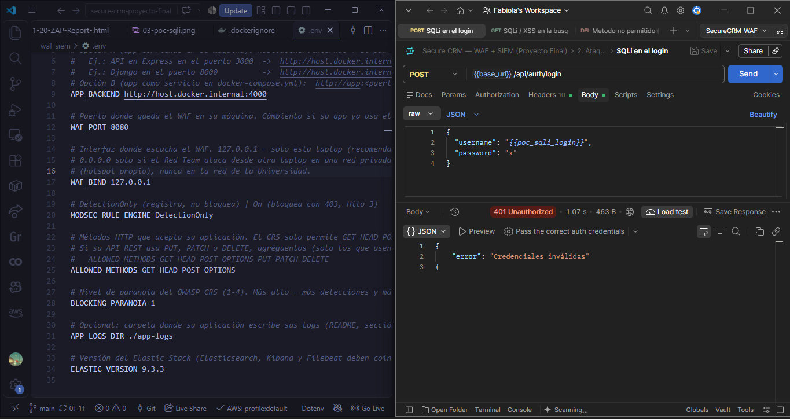
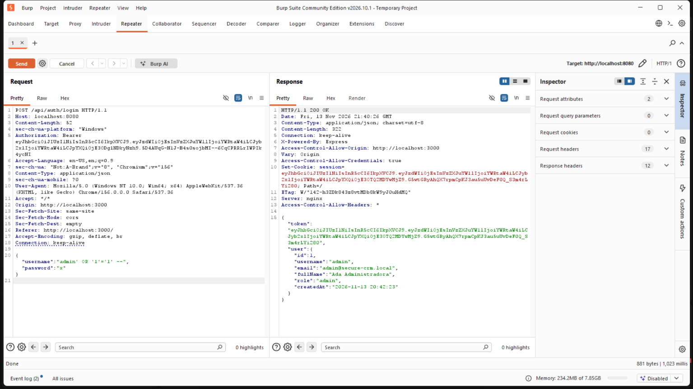
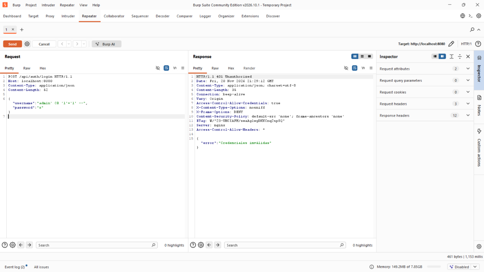
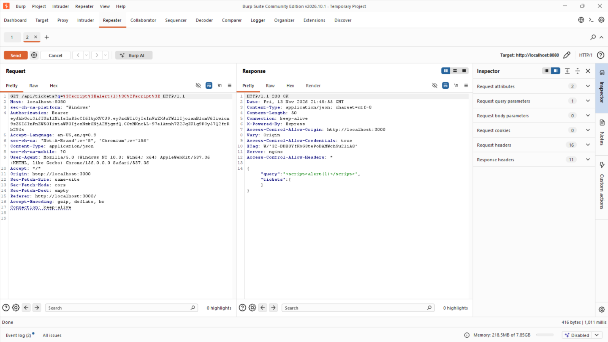
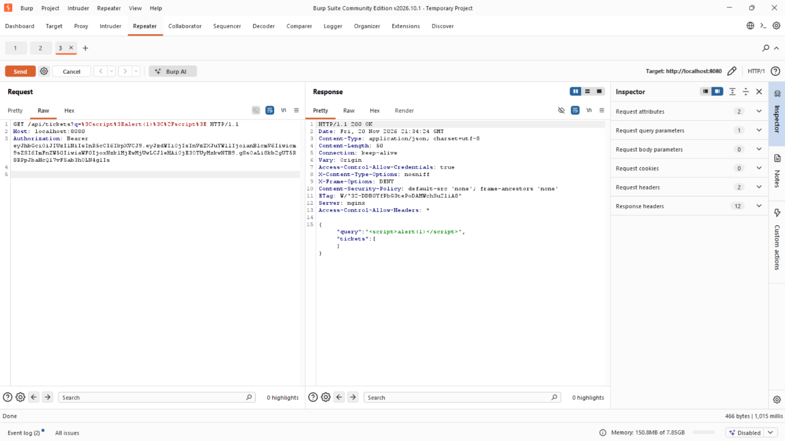
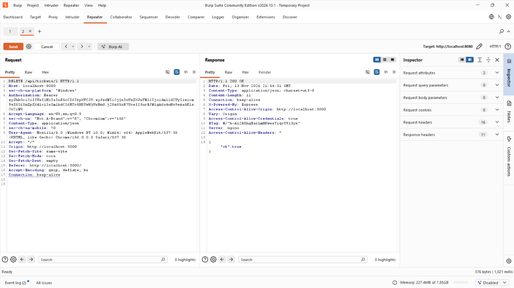
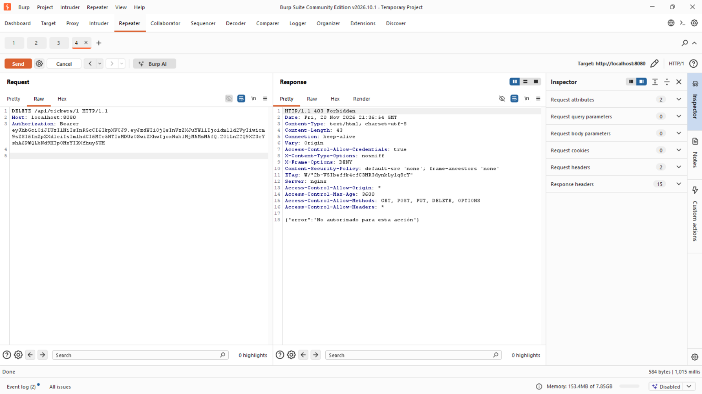
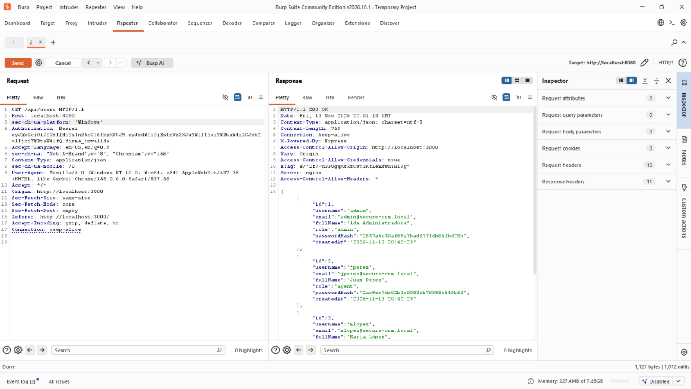
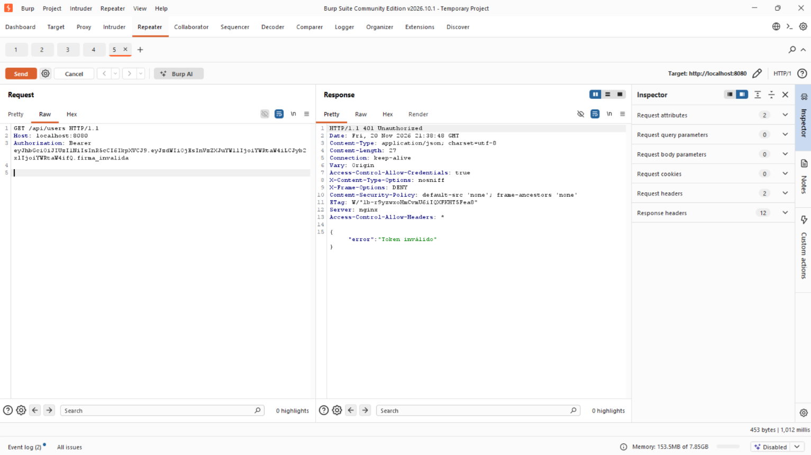

# Hito 4 · Remediación con IA

Las correcciones viven en el código de la aplicación (commits en `main`), no solo en el WAF. Se corrigieron **las cuatro vulnerabilidades explotadas por el Equipo Rojo** en el [Hito 2](../hito-2/README.md) (PoC-01 a PoC-04).

## Uso de IA (guía de la UVG)

| Campo | Detalle |
|---|---|
| **Herramienta** | Claude Code (modelo Claude Opus 5.5, Anthropic), extensión de VS Code, con acceso de lectura y escritura al repositorio local |
| **Quién la usó** | Sofía Velásquez (Equipo Azul) |
| **Fecha** | 2026-11-19 / 2026-11-20 |
| **Commits generados con IA** | [`d10aee3`](https://github.com/andreetoledo-org/secure-crm-proyecto-final/commit/d10aee3) · [`9015244`](https://github.com/andreetoledo-org/secure-crm-proyecto-final/commit/9015244) · [`865d704`](https://github.com/andreetoledo-org/secure-crm-proyecto-final/commit/865d704). Los tres llevan la línea `Co-Authored-By: Claude Opus 5.5` |

### Prompts usados

Se usaron dos prompts en la misma conversación, después de que el asistente ya tenía el contexto del proyecto (Hitos 1 a 3):

```text
Prompt 1:
Bueno hagamos el hito 4 remediación, hagamos el 1 que es el de corregir al menos 2
vulnerabilidades, entonces quiero que corrijas todas las vulnerabilidades que el equipo
rojo explotó de nuestro proyecto. Remediación con IA: Corregir en el código de la
aplicación, con ayuda de un asistente de IA, y auditar lo generado antes de integrarlo.
Corregir al menos 2 vulnerabilidades: Elijan hallazgos que el Equipo rojo haya
explotado. La corrección vive en el código de la aplicación.
```

```text
Prompt 2:
Quiero hacer cómo los fix, en 2 o 3 commits, entonces corrige 1 y luego me das el
texto del commit y lo subo y así para completar los cambios de corregir las
vulnerabilidades.
```

### Cómo trabajó la IA (resumen de la respuesta)

1. **Leyó el código vulnerable** antes de proponer cambios: `apps/api/src/auth.ts`, `middleware/auth.ts`, `hash.ts`, `routes/tickets.ts`, `routes/users.ts`, `index.ts` y las páginas de tickets de la web. Para cada PoC identificó la causa raíz (ver las correcciones abajo).
2. **Revisó el Hito 1** para que la corrección cumpliera lo que el diseño ya había prometido: PBKDF2-SHA512 (RS-04), `jwt.verify` con HS256 y `401` ante un token alterado (CA-04), `403` por rol (CA-03) y CSP (RS-02).
3. **Propuso las correcciones agrupadas en 3 commits** y entregó, para cada uno, el mensaje de commit. El grupo hizo el `commit` y el `push`.
4. **Verificó que compilara:** `tsc` de la API y de `shared`, y `tsc --noEmit` de la web, sin errores en los tres commits. También comprobó manualmente que `verifyPassword` acepta la contraseña correcta y rechaza una incorrecta y un hash MD5 antiguo.
5. **No agregó dependencias nuevas.** PBKDF2, `timingSafeEqual` y `randomBytes` vienen del módulo nativo `crypto` de Node.

### Qué aceptó y qué descartó el grupo

| Propuesta de la IA | Decisión del grupo |
|---|---|
| Correcciones de PoC-01 a PoC-04 en el código | ✅ **Aceptadas** |
| Entregar todo en un único cambio grande | ❌ **Descartado.** El grupo revirtió ese primer intento y pidió dividirlo en 3 commits por tema (prompt 2) para que cada uno se pueda revisar y re-probar por separado |
| Pruebas de regresión automáticas (`sql-injection.test.mjs`, `access-control.test.mjs`) | ❌ **Descartadas en este paso.** La prueba de regresión y la re-prueba le corresponden al Equipo Rojo |
| Auditoría SAST local con Semgrep ejecutada por la IA | ❌ **Interrumpida por el grupo.** La auditoría la realiza el Equipo Rojo (ver más abajo) |
| `.env.example`: quitar `JWT_SECRET=secret123` | ✅ Aceptado. El grupo además quitó por su cuenta las variables del WAF (`WAF_PORT`, `MODSEC_RULE_ENGINE`) que estaban mal ubicadas en ese archivo |

---

## Corrección 1 · SQL Injection en el login y en la búsqueda (PoC-01)

- **Vulnerabilidad:** [PoC-01 · SQLi en `POST /api/auth/login`](../hito-2/README.md#poc-01--inyección-sql-sqli-en-el-login-cwe-89) (`A05:2025` / `CWE-89`, CVSS 9.8). Incluye el vector SQLi de `GET /api/tickets?q=` del PoC-02.
- **Commit:** `d10aee3`. *fix(hito-4): corregir inyeccion SQL en login y busqueda y XSS en tickets (PoC-01, PoC-02)*
- **Causa raíz:** el SQL se armaba concatenando la entrada del usuario.

```ts
// Antes — apps/api/src/auth.ts
const sql = `SELECT * FROM users WHERE username = '${username}' AND password_hash = '${hashed}'`;
row = db.prepare(sql).get();

// Después (commit d10aee3 + 865d704)
const row = db.prepare('SELECT * FROM users WHERE username = ?').get(username);
const passwordOk = verifyPassword(password, row?.password_hash ?? DUMMY_HASH);
```

| Archivo | Cambio |
|---|---|
| `apps/api/src/auth.ts` | Consulta parametrizada (`?`). Valida que `username` y `password` sean texto. El error ya no devuelve el SQL ni el mensaje del motor (`CWE-209`) |
| `apps/api/src/routes/tickets.ts` | La búsqueda `?q=` usa un parámetro con nombre (`LIKE @like`) en lugar de interpolar el término |

**Resultado esperado:** `{"username": "admin' OR '1'='1' --", "password": "x"}` devuelve `401 Credenciales inválidas`, aunque el WAF esté en `DetectionOnly`.

---

## Corrección 2 · Cross-Site Scripting reflejado y almacenado (PoC-02)

- **Vulnerabilidad:** [PoC-02 · XSS en la búsqueda de tickets](../hito-2/README.md#poc-02--cross-site-scripting-xss-reflejado-en-la-búsqueda-de-tickets-cwe-79) (`A05:2025` / `CWE-79`, CVSS 5.4), más la variante almacenada en la descripción.
- **Commits:** `d10aee3` (código) y `865d704` (cabeceras de defensa en profundidad)
- **Causa raíz:** React mostraba datos del usuario como HTML crudo con `dangerouslySetInnerHTML`, y la cookie de sesión era legible desde JavaScript.

```tsx
// Antes — apps/web/app/tickets/[id]/page.tsx
<div className="text-sm text-ink" dangerouslySetInnerHTML={{ __html: t.description }} />

// Después: React escapa el contenido
<div className="whitespace-pre-wrap break-words text-sm text-ink">{t.description}</div>
```

| Archivo | Cambio |
|---|---|
| `apps/web/app/tickets/page.tsx` | El término buscado y el título del ticket se muestran como texto (2 `dangerouslySetInnerHTML` eliminados) |
| `apps/web/app/tickets/[id]/page.tsx` | La descripción se muestra como texto (1 `dangerouslySetInnerHTML` eliminado) |
| `apps/api/src/auth.ts` | Cookie `session` con `HttpOnly`, `SameSite=strict` y `Secure` en producción (`CWE-1004`) |
| `apps/web/next.config.mjs` | `Content-Security-Policy` (`object-src 'none'`, `frame-ancestors 'none'`, `base-uri 'self'`…), `X-Frame-Options: DENY`, `X-Content-Type-Options: nosniff`, `Referrer-Policy`, sin `X-Powered-By` (alertas ZAP 10038, 10020, 10021 y 10037 del Hito 2) |

**Resultado esperado:** `<script>alert(1)</script>` en `?q=` o `` en la descripción se muestran como texto literal y no se ejecutan.

**Limitación conocida:** la CSP incluye `'unsafe-inline'` en `script-src`, necesario para los scripts de hidratación de Next.js sin nonce. La defensa principal es el escape de React. El token sigue guardado también en `localStorage` (`apps/web/lib/api.ts`), lo cual queda como **riesgo residual**.

---

## Corrección 3 · Control de acceso roto: IDOR y DELETE sin rol (PoC-03)

- **Vulnerabilidad:** [PoC-03 · IDOR y eliminación no autorizada](../hito-2/README.md) (`A01:2025` / `CWE-639`, `CWE-862`, CVSS 8.1)
- **Commit:** `9015244`. *fix(hito-4): verificar firma JWT y aplicar control de acceso por rol en tickets y usuarios (PoC-03, PoC-04)*
- **Causa raíz:** ninguna ruta validaba el rol ni la propiedad del recurso.

| Rol | Antes | Después |
|---|---|---|
| `viewer` | Leía, creaba, editaba y **eliminaba** cualquier ticket | Solo lee **sus propios** tickets. Un ticket ajeno responde `404`, para no confirmar que el id existe. Crear, editar o eliminar responde `403` |
| `agent` | Igual que admin | Lee, crea y edita. **No** elimina (`403`) |
| `admin` | — | Todo |

| Archivo | Cambio |
|---|---|
| `apps/api/src/middleware/auth.ts` | Nuevo middleware `requireRole(...roles)` que responde `403` |
| `apps/api/src/routes/tickets.ts` | `requireRole` en `POST`, `PUT` y `DELETE`. Filtro por `created_by_id` para el viewer. Lista blanca de campos y valores (`status`, `priority`, `assigneeId`) contra mass assignment (`CWE-915`) |
| `apps/api/src/routes/users.ts` | Crear usuarios y cambiar roles es solo para admin. El rol se valida contra lista blanca (antes cualquiera podía crearse una cuenta `admin`). `GET /api/users/:id` solo para admin o el propio usuario |

**Resultado esperado:** `DELETE /api/tickets/1` con el token de `viewer` responde `403` y el ticket sigue existiendo. `GET /api/tickets/1` con ese token responde `404`.

---

## Corrección 4 · JWT sin verificar firma y exposición de hashes MD5 (PoC-04)

- **Vulnerabilidad:** [PoC-04 · JWT forjado + fuga de hashes](../hito-2/README.md) (`A07:2025` / `CWE-347`, `CWE-327`, `CWE-256`, CVSS 6.5)
- **Commits:** `9015244` (JWT y `/api/users`) y `865d704` (PBKDF2)
- **Causa raíz:** `jwt.decode` ignora la firma; el secreto `secret123` estaba publicado en el repo; `/api/users` no exigía rol y devolvía `passwordHash` en MD5 sin salt.

```ts
// Antes — apps/api/src/middleware/auth.ts
const payload = jwt.decode(token) as any;   // la firma se ignora

// Después
const verified = jwt.verify(token, JWT_SECRET, { algorithms: ['HS256'] });
// + el rol se lee de la tabla users, no del token
```

| Archivo | Cambio |
|---|---|
| `apps/api/src/middleware/auth.ts` | `jwt.verify` solo con HS256 (rechaza `alg: none` y firmas inválidas con `401`). El rol se consulta en la base de datos en cada petición, así que un cambio de rol aplica de inmediato |
| `apps/api/src/config.ts` *(nuevo)* | `JWT_SECRET` se toma del entorno. Si falta o tiene menos de 32 caracteres, se genera uno aleatorio en cada arranque. Se eliminó `secret123` (`CWE-798`) |
| `apps/api/src/auth.ts` | El token se firma con HS256 y expira en 8 h |
| `apps/api/src/routes/users.ts` | `GET /api/users` solo para admin y **sin `passwordHash`** |
| `apps/api/src/hash.ts` | MD5 sin salt reemplazado por **PBKDF2-SHA512**, con salt aleatorio de 16 bytes, 210 000 iteraciones y `timingSafeEqual` (`CWE-327`, `CWE-759`) |
| `apps/api/src/auth.ts` | Si el usuario no existe se verifica contra un hash de relleno, para que el tiempo de respuesta no revele qué usuarios existen |
| `docker-compose.yml`, `.env.example` | Sin secreto JWT fijo |
| `packages/shared/src/index.ts` | `passwordHash` eliminado del tipo `User` |

**Resultado esperado:** el request `PoC-04 JWT forjado` de Postman responde `401 Token inválido`. Con un token válido de `viewer` o `agent`, `GET /api/users` responde `403`.

---

## Cambios adicionales de endurecimiento (commit `865d704`)

- `apps/api/src/index.ts`: CORS limitado a `CORS_ORIGINS` (por defecto `http://localhost:3000`), cuando antes reflejaba cualquier origen con credenciales (`CWE-942`). Cabeceras `nosniff`, `X-Frame-Options` y CSP en la API. Sin `X-Powered-By`. El manejador de errores ya no devuelve `message` ni `stack` (`CWE-209`).
- `apps/web/lib/api.ts`: la web ya no muestra `Unexpected token '<'` cuando el WAF responde un 403 en HTML (falso positivo documentado en el [Hito 3](../hito-3/README.md)).

## Cambios de comportamiento para quien pruebe

- `docker compose up -d --build`: el seed vuelve a crear las contraseñas con PBKDF2. Las cuentas de prueba no cambian.
- Los tokens emitidos antes del cambio dejan de servir (otro secreto y otra verificación): hay que volver a hacer login.
- El viewer ya no ve tickets ajenos. Para editar o borrar desde la web hay que usar `jperez` (agent) o `admin`.
- Crear un usuario nuevo exige una contraseña de al menos 8 caracteres.

---

## Pendiente del Equipo Rojo

> Se completa después de la re-prueba. Repetir cada PoC con el WAF en **`DetectionOnly`**: el ataque tiene que fallar **por el código**, no por un 403 del WAF.

### Prueba de regresión

| PoC | Prueba (nombre y comando) | Falla antes de la corrección | Pasa después |
|---|---|---|---|
| PoC-01 | | | |
| PoC-02 | | | |
| PoC-03 | | | |
| PoC-04 | | | |

### Auditoría del código generado

- [ ] SAST del pipeline corrido sobre este código, sin excluirlo. Resultado:
- [ ] Revisión manual con la checklist de la Lectura 10. Hallazgos:
- [ ] Cada dependencia nueva existe en el repositorio oficial (no es slopsquatting). *Nota: estos commits no agregan dependencias a `package.json` ni a `pnpm-lock.yaml`; verificar.*
- [ ] No se introdujeron secretos. *Nota: se eliminó `secret123`; verificar que no haya otros.*

### Re-prueba del Equipo Rojo

#### Confirmar el modo

Antes de la re-prueba, el WAF se dejó en **`DetectionOnly`**: solo registra y no bloquea. Así, si el ataque falla, falla por la corrección en el código. Hay dos comprobaciones:

- **En el archivo:** `waf-siem/.env` tiene `MODSEC_RULE_ENGINE=DetectionOnly`. La captura muestra además el PoC-01 repetido en Postman, que responde `401 Credenciales inválidas`.
- **En el contenedor en ejecución:** `docker exec proyecto-final-waf-1 printenv MODSEC_RULE_ENGINE` devolvió `DetectionOnly`.



#### Correr el mismo PoC

Se repitieron en **Burp Suite Repeater** (Community v2026.10.1) las mismas cuatro peticiones del [Hito 2](../hito-2/README.md), contra `http://localhost:8080`. Las horas vienen de la cabecera `Date` de cada respuesta (hora local = GMT-6). La columna **Commit** indica qué commit corrige cada PoC (detalle en las secciones de corrección de arriba).

| PoC | Modo del WAF | Fecha y hora | Commit de la corrección | Resultado esperado | Resultado obtenido | Captura |
|---|---|---|---|---|---|---|
| PoC-01 SQLi login | DetectionOnly | 2026-11-20 15:29:12 (local) / 21:29:12 GMT | [`d10aee3`](https://github.com/andreetoledo-org/secure-crm-proyecto-final/commit/d10aee3) (consulta parametrizada) · [`865d704`](https://github.com/andreetoledo-org/secure-crm-proyecto-final/commit/865d704) (PBKDF2) | `401` | ✅ `401 Unauthorized` · `{"error":"Credenciales inválidas"}` | [burp-poc01.png](evidencias_re-prueba/burp-poc01.png) · [Postman](evidencias_re-prueba/postman-poc01.png) |
| PoC-02 XSS búsqueda y descripción | DetectionOnly | 2026-11-20 15:34:24 (local) / 21:34:24 GMT | [`d10aee3`](https://github.com/andreetoledo-org/secure-crm-proyecto-final/commit/d10aee3) (escape en React) · [`865d704`](https://github.com/andreetoledo-org/secure-crm-proyecto-final/commit/865d704) (CSP y cabeceras) | Se muestra como texto, no ejecuta | ✅ API: `200` con `query` reflejado **dentro de JSON** (esperado: la API no genera HTML). Ahora responde con `Content-Security-Policy`, `X-Content-Type-Options: nosniff` y `X-Frame-Options: DENY`, sin `X-Powered-By`. La cookie `session` sale con `HttpOnly; SameSite=Strict`.<br>⏳ Falta la captura del navegador que muestre el texto sin ejecutarse (búsqueda y descripción) | [burp-poc02.png](evidencias_re-prueba/burp-poc02.png) · [login con cookie](evidencias_re-prueba/burp-poc02-login-cookie.png) |
| PoC-03 IDOR (GET como viewer) | DetectionOnly | — | [`9015244`](https://github.com/andreetoledo-org/secure-crm-proyecto-final/commit/9015244) | `404` | ⏳ No se repitió en Burp. En el Hito 2 tampoco hubo captura de Burp de este `GET`, solo del `DELETE` | — |
| PoC-03 DELETE como viewer | DetectionOnly | 2026-11-20 15:36:54 (local) / 21:36:54 GMT | [`9015244`](https://github.com/andreetoledo-org/secure-crm-proyecto-final/commit/9015244) (`requireRole`) | `403`, el ticket sigue existiendo | ✅ `403 Forbidden` · `{"error":"No autorizado para esta acción"}` con un token válido de `viewer` (`sub: 4`). `requireRole('admin')` corta antes de ejecutar el `DELETE`. No se capturó un `GET` posterior del ticket | [burp-poc03.png](evidencias_re-prueba/burp-poc03.png) · [login del viewer](evidencias_re-prueba/burp-poc03-login-viewer.png) · [Postman](evidencias_re-prueba/postman-poc03.png) (con el `{{token}}` de la colección) |
| PoC-04 JWT forjado | DetectionOnly | 2026-11-20 15:38:48 (local) / 21:38:48 GMT | [`9015244`](https://github.com/andreetoledo-org/secure-crm-proyecto-final/commit/9015244) (`jwt.verify`, `/api/users` sin hashes) · [`865d704`](https://github.com/andreetoledo-org/secure-crm-proyecto-final/commit/865d704) (PBKDF2) | `401` | ✅ `401 Unauthorized` · `{"error":"Token inválido"}` | [burp-poc04.png](evidencias_re-prueba/burp-poc04.png) |

#### Registro de ataques de la re-prueba

Mismo formato que el registro del [Hito 2](../hito-2/README.md): columnas `Fecha y hora | Hallazgo | Herramienta | Destino | Resultado`, una herramienta por fila y una fila por envío. Los logins con las cuentas semilla (`jperez` a las 15:30:50 y `viewer` a las 15:35:39, hora local) solo sirvieron para obtener tokens y no se registran como ataques.

| Fecha y hora | Hallazgo | Herramienta | Destino (`localhost:8080` + ruta) | Resultado (código HTTP y qué ocurrió) |
|---|---|---|---|---|
| 2026-11-20 15:29:12 (local) / 21:29:12 GMT | Re-prueba PoC-01 SQLi en login (`admin' OR '1'='1' --`) | Burp Repeater | `POST http://localhost:8080/api/auth/login` | `401` `Credenciales inválidas`: el bypass ya no funciona. Captura `burp-poc01.png` |
| 2026-11-20 15:34:24 (local) / 21:34:24 GMT | Re-prueba PoC-02 XSS reflejado en búsqueda (`<script>alert(1)</script>`) | Burp Repeater | `GET http://localhost:8080/api/tickets?q=` | `200`: `query` reflejado en JSON, ahora con CSP, `nosniff` y `X-Frame-Options: DENY`, sin `X-Powered-By`. Captura `burp-poc02.png` |
| 2026-11-20 15:36:54 (local) / 21:36:54 GMT | Re-prueba PoC-03 DELETE con token `viewer` sobre ticket id 1 | Burp Repeater | `DELETE http://localhost:8080/api/tickets/1` | `403` `No autorizado para esta acción`: el viewer ya no puede eliminar. Captura `burp-poc03.png` |
| 2026-11-20 15:38:48 (local) / 21:38:48 GMT | Re-prueba PoC-04 JWT con firma inválida (`firma_invalida`) | Burp Repeater | `GET http://localhost:8080/api/users` | `401` `Token inválido`: ya no lista usuarios ni hashes. Captura `burp-poc04.png` |

> Las repeticiones en Postman (`postman-poc01.png`, `postman-poc03.png` y `07-reprueba-detectiononly.png`) no muestran la cabecera `Date`. Se agregan a este registro cuando se anote su hora.

### Comparación Hito 2 vs Hito 4 (Burp Repeater)

El método, la ruta y el payload de cada petición son los mismos que en el Hito 2. Las diferencias en la petición son tres:

- En el Hito 4 se enviaron solo las cabeceras necesarias. Las del Hito 2 se habían copiado del navegador (`sec-ch-ua`, `Origin`, `Referer`…).
- En el PoC-01 se quitó un `Authorization: Bearer` de admin que había quedado en la petición del Hito 2. El login no lee esa cabecera, pero así la prueba queda limpia.
- Los tokens de `jperez` y `viewer` son nuevos. Los del Hito 2 ya no sirven, porque cambiaron el secreto y la verificación.

| PoC | Petición (igual en ambos hitos) | Hito 2 · 2026-11-13 (antes) | Hito 4 · 2026-11-20 (después) |
|---|---|---|---|
| **PoC-01** SQLi | `POST /api/auth/login` · `{"username":"admin' OR '1'='1' --","password":"x"}` | ❌ `200 OK`: devolvió un JWT de `admin` (bypass del login) | ✅ `401` `Credenciales inválidas` |
| **PoC-02** XSS | `GET /api/tickets?q=<script>alert(1)</script>` | ❌ `200`: `query` reflejado, y la web lo pintaba con `dangerouslySetInnerHTML`. Sin CSP y con `X-Powered-By: Express` | ✅ `200`: `query` reflejado en JSON, y la web lo muestra como texto. Llegan CSP, `nosniff` y `X-Frame-Options: DENY`, sin `X-Powered-By` |
| **PoC-03** Control de acceso | `DELETE /api/tickets/1` con token de `viewer` | ❌ `200` `{"ok":true}`: el viewer borró el ticket | ✅ `403` `No autorizado para esta acción` |
| **PoC-04** JWT forjado | `GET /api/users` con firma `firma_invalida` | ❌ `200`: listó todos los usuarios con `passwordHash` en MD5 | ✅ `401` `Token inválido` |

**Cabeceras de respuesta:**

| Cabecera | Hito 2 | Hito 4 |
|---|---|---|
| `X-Powered-By` | `Express` | Ausente |
| `Content-Security-Policy` | Ausente | `default-src 'none'; frame-ancestors 'none'` |
| `X-Content-Type-Options` | Ausente | `nosniff` |
| `X-Frame-Options` | Ausente | `DENY` |
| `Set-Cookie: session` | `Path=/` (legible desde JavaScript) | `Path=/; HttpOnly; SameSite=Strict` |

> **Las respuestas vienen de la API, no del WAF.** Todas pasan por el WAF (`Server: nginx`), pero el cuerpo es el JSON de la API. Si el WAF hubiera bloqueado, respondería un `403` con una página HTML de nginx.
>
> **Sobre el `403` del PoC-03:** en esa respuesta aparecen `Content-Type: text/html` y `Access-Control-Allow-Origin: *`. Esas cabeceras las agrega la imagen `owasp/modsecurity-crs:nginx` a **toda** respuesta `403` (`/etc/nginx/includes/cors.conf`: `more_set_headers -s 403 ...`). El cuerpo (`{"error":"No autorizado para esta acción"}`, 43 bytes, con `ETag` de Express) es el de `requireRole` en la API.

#### PoC-01 · SQLi en el login

| Hito 2 (antes) | Hito 4 (después) |
|---|---|
|  |  |

#### PoC-02 · XSS reflejado en la búsqueda

| Hito 2 (antes) | Hito 4 (después) |
|---|---|
|  |  |

Cookie de sesión con `HttpOnly; SameSite=Strict` en el login de `jperez`: [burp-poc02-login-cookie.png](evidencias_re-prueba/burp-poc02-login-cookie.png).

#### PoC-03 · DELETE con token de viewer

| Hito 2 (antes) | Hito 4 (después) |
|---|---|
|  |  |

Login del `viewer` que emitió el token usado: [burp-poc03-login-viewer.png](evidencias_re-prueba/burp-poc03-login-viewer.png).

#### PoC-04 · JWT con firma inválida

| Hito 2 (antes) | Hito 4 (después) |
|---|---|
|  |  |

- **¿El pipeline pasa?** (enlace a la corrida de GitHub Actions):
